<!--START:HEADER-->
<p align="center">
  
</p>

<p align="center">
  <a href="https://github.com/Sujalranjan">
    
  </a>
</p>

<p align="center">
  <a href="https://github.com/Sujalranjan?tab=followers"></a>
  
</p>
<!--END:HEADER-->

---

## `$ whoami`

<!--START:WHOAMI-->
```python
class SujalRanjan:
    role       = "Full-Stack & AI Engineer"
    building   = "WorkFlow-OS: Learns the routine work you repeat across apps and runs it..."
    focus      = ["retrieval & RAG", "LLM-powered automation", "data pipelines & MLOps"]
    learning   = ["retrieval evaluation", "agentic workflows", "production ML"]
    open_to    = ["collaborations", "hackathons", "open source"]
    philosophy = "If I do it twice, I automate it the third time."

    def say_hi(self):
        print("Thanks for dropping by. Let's build something that saves people time! ⚡")
```
<!--END:WHOAMI-->

## ⚡ Impact at a Glance

<!--START:IMPACT-->
<table>
<tr>
<td align="center" width="25%"><h2>+5.3%</h2><sub>Recall@5 from hybrid search over vector-only (BEIR SciFact)<br/><a href="https://github.com/Sujalranjan/MemBrain">MemBrain</a></sub></td>
<td align="center" width="25%"><h2>513K</h2><sub>real road-collision records in an Airflow + MLflow pipeline<br/><a href="https://github.com/Sujalranjan/Traffic-Accident-Severity-Analytics-and-Prediction">Traffic Analytics</a></sub></td>
<td align="center" width="25%"><h2>86</h2><sub>automated tests in CI on Python 3.10 and 3.12<br/><a href="https://github.com/Sujalranjan/MemBrain">MemBrain</a></sub></td>
<td align="center" width="25%"><h2>216</h2><sub>contributions in the last year</sub></td>
</tr>
</table>
<!--END:IMPACT-->

---

## 🌟 Featured Projects

<!--START:FEATURED-->
<table>
<tr>
<td width="50%" valign="top">
<h3>🧠 <a href="https://github.com/Sujalranjan/MemBrain">MemBrain</a></h3>
<p>A self-hosted knowledge base for teams: capture notes, decisions, SOPs and voice memos, then search by meaning and get cited answers.</p>
<ul><li>Hybrid vector + BM25 search fused with RRF: +5.3% Recall@5 on BEIR SciFact</li><li>BM25 written in SQL lifted keyword Recall@5 from 0.07 to 0.75</li><li>All in PostgreSQL: pgvector, job queue and rate limiting; 86 tests in CI</li></ul>
<p>    </p>
<p><a href="https://github.com/Sujalranjan/MemBrain"><b>Code →</b></a></p>
</td>
<td width="50%" valign="top">
<h3>⚙️ <a href="https://github.com/Sujalranjan/WorkFlow-OS">WorkFlow OS</a></h3>
<p>Watches the routine work you repeat across apps, turns it into a workflow you approve, then runs it for you, with a dry run first.</p>
<ul><li>Desktop agent and browser extension observe real activity</li><li>Deterministic action catalog; LLM output is validated so it can&#x27;t re-route steps</li><li>Executes through Gmail, a CRM and Slack, each with an independent verifier</li></ul>
<p>    </p>
<p><a href="https://github.com/Sujalranjan/WorkFlow-OS"><b>Code →</b></a></p>
</td>
</tr>
<tr>
<td width="50%" valign="top">
<h3>🚦 <a href="https://github.com/Sujalranjan/Traffic-Accident-Severity-Analytics-and-Prediction">Traffic Accident Analytics</a></h3>
<sub>👥 Team project · 🟢 Live demo</sub><br/><p>End-to-end data engineering and MLOps system that predicts accident severity from UK road-safety and weather data.</p>
<ul><li>513,801 STATS19 collisions joined with hourly Open-Meteo weather</li><li>Star-schema warehouse in PostgreSQL/PostGIS behind a data-quality gate</li><li>Airflow DAG with MLflow tracking and conditional retraining</li></ul>
<p>    </p>
<p><a href="https://github.com/Sujalranjan/Traffic-Accident-Severity-Analytics-and-Prediction"><b>Code →</b></a> &nbsp;·&nbsp; <a href="https://traffic-accident-severity-analytics-and-prediction-3yzwgf7tuhc.streamlit.app/"><b>Live demo ↗</b></a></p>
</td>
<td width="50%" valign="top">
<h3>🗺️ <a href="https://github.com/Sujalranjan/GitOnboard">GitOnboard</a></h3>
<sub>👥 Team project</sub><br/><p>Turns any GitHub repository into an interactive knowledge graph so new developers onboard faster.</p>
<ul><li>Multi-language AST parsing with Tree-sitter</li><li>Semantic code search, dependency and impact analysis</li><li>FastAPI + Next.js + PostgreSQL, all in Docker Compose</li></ul>
<p>    </p>
<p><a href="https://github.com/Sujalranjan/GitOnboard"><b>Code →</b></a></p>
</td>
</tr>
</table>
<!--END:FEATURED-->

---

## 🧠 Tech Arsenal
<sub>Auto-detected from the languages, dependencies and topics in my repos. It grows every time I pick up something new.</sub>

<!--START:SKILLS-->
<h4>💻 Languages</h4>
<p>
  
  
  
  
</p>
<h4>⚙️ Frameworks & Libraries</h4>
<p>
  
  
  
  
  
  
  
  
  
  
  
  
  
  
  
  
  
</p>
<h4>🛠️ Tools, Platforms & Integrations</h4>
<p>
  
  
  
  
  
  
  
  
  
  
  
</p>
<!--END:SKILLS-->

---

## 🔭 More Builds
<sub>Updated automatically. A new repo shows up here on its own.</sub>

<!--START:PROJECTS-->
| 🚀 Project | 📝 What it does | 🧰 Stack | 🕒 Updated |
|---|---|---|---|
| [**placement-prediction**](https://github.com/Sujalranjan/placement-prediction) <sub>👥 team</sub> | End-to-end Student Placement & Salary Package Prediction dashboard using a calibrated Scikit-Learn Random F… | `Python` | 1 mo ago |
| [**MailEaseAI**](https://github.com/Sujalranjan/MailEaseAI) | AI email assistant: syncs your inbox over IMAP, groups threads and turns emails into tasks with deadlines. | `Python` | 1 mo ago |
| [**Smart-Bill-Reader**](https://github.com/Sujalranjan/Smart-Bill-Reader) | AI-Powered Expense Automation Platform built with React Native and Python Flask. Features automated invoice… | `TypeScript` | 11 mo ago |
<!--END:PROJECTS-->

---

## 📊 Code Telemetry

<!--START:LANGS-->
```text
$ git-stats --languages --user Sujalranjan

Python            ████████████████████░░░░░   80.2 %
TypeScript        ███░░░░░░░░░░░░░░░░░░░░░░   12.5 %
HTML              ██░░░░░░░░░░░░░░░░░░░░░░░    6.4 %
JavaScript        ░░░░░░░░░░░░░░░░░░░░░░░░░    0.9 %
```
<!--END:LANGS-->

<!--START:STATS-->
<p align="center">
  
  
</p>
<!--END:STATS-->

---

## ⚡ Live Activity Feed

<!--START:ACTIVITY-->
1. ⬆️ Pushed 1 commit to [Sujalranjan/GitOnboard](https://github.com/Sujalranjan/GitOnboard) · <sub>5 d ago</sub>
2. ⬆️ Pushed 1 commit to [Sujalranjan/WorkFlow-OS](https://github.com/Sujalranjan/WorkFlow-OS) · <sub>6 d ago</sub>
3. ⬆️ Pushed 1 commit to [Sujalranjan/Sujalranjan](https://github.com/Sujalranjan/Sujalranjan) · <sub>6 d ago</sub>
4. ⬆️ Pushed 1 commit to [Sujalranjan/WorkFlow-OS](https://github.com/Sujalranjan/WorkFlow-OS) · <sub>6 d ago</sub>
5. ⬆️ Pushed 1 commit to [Sujalranjan/MemBrain](https://github.com/Sujalranjan/MemBrain) · <sub>8 d ago</sub>
<!--END:ACTIVITY-->

---

## 🐍 Contribution Hunter

<picture>
  <source media="(prefers-color-scheme: dark)" srcset="./assets/snake-dark.svg" />
  <source media="(prefers-color-scheme: light)" srcset="./assets/snake-light.svg" />
  
</picture>

---

## 🤝 Let's Connect

<!--START:CONNECT-->
<p align="center">
  <a href="https://github.com/Sujalranjan"></a>
</p>
<!--END:CONNECT-->

<p align="center">
<!--START:UPDATED-->
<sub>🤖 Auto-generated by GitHub Actions · last sync 30 Oct 2026, 05:29 UTC · 7 public repos scanned</sub>
<!--END:UPDATED-->
</p>


